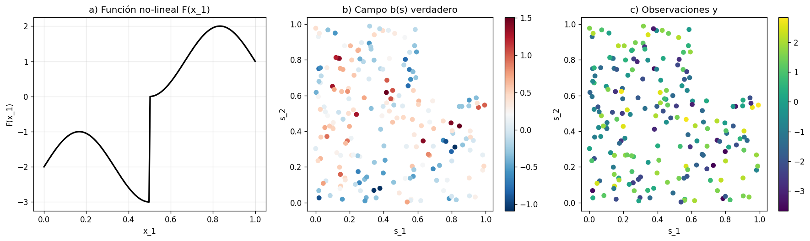

# Reproducción y extensión del algoritmo GPBoost para datos espaciales

**Autores:** Lina Quintero, Santiago Rodríguez
**Curso:** Percepción Remota, Maestría en Geomática, Universidad Nacional de Colombia
**Fecha:** 20 de mayo de 2026

---

## Resumen

El algoritmo GPBoost, propuesto por Sigrist (2020), articula tree-boosting con modelos de proceso gaussiano bajo la formulación $y = F(X) + b(s) + e$, de modo que el componente fijo $F(X)$ aprende relaciones no-lineales entre covariables mientras que el componente aleatorio $b(s)$ modela explícitamente la dependencia espacial entre observaciones. El presente trabajo reproduce el ejemplo simulado del artículo divulgativo de Sigrist (2021) y propone cuatro extensiones que profundizan en el manejo de la dependencia espacial: la normalización de covariables seguida de búsqueda en rejilla con validación cruzada, la comparación de cuatro funciones de covarianza, la confrontación entre validación cruzada aleatoria y validación cruzada espacial por bloques, y el análisis del variograma empírico de los residuales como diagnóstico de la captura del componente espacial. Los resultados confirman el desempeño superior de GPBoost respecto a Linear GP, L2Boost y Random Forest sobre la simulación —con un RMSE de 0,6073 frente a 1,0915, 0,6500 y 0,6905 respectivamente—, evidencian que la validación cruzada aleatoria subestima sistemáticamente el RMSE en aproximadamente un cuatro por ciento al ignorar la autocorrelación espacial, y muestran que el GP captura el ochenta y ocho por ciento de la estructura espacial de los residuales out-of-sample. La contribución metodológica principal es la documentación del gap entre validación cruzada y test, así como la justificación de la validación espacial por bloques como estimador honesto del desempeño predictivo en contextos de monitoreo ambiental.

---

## 1. Introducción

La predicción sobre datos espaciales constituye una de las tareas más recurrentes en geomática y percepción remota, toda vez que las variables ambientales que interesan al monitoreo de ecosistemas —biomasa aérea, cobertura del dosel, estado fisiológico de la vegetación, contenido de carbono orgánico del suelo— se observan típicamente en localidades discretas y deben extrapolarse a regiones más amplias. Dos familias metodológicas han madurado de manera paralela para abordar este problema. Por una parte, los modelos de proceso gaussiano y la geoestadística tradicional —representada por el universal kriging y sus variantes— modelan de manera explícita la estructura de autocorrelación espacial bajo el principio de Tobler según el cual los fenómenos cercanos en el espacio tienden a ser más similares entre sí que los lejanos, en la medida en que asumen una función de covarianza paramétrica que decae con la distancia. Por otra parte, los métodos de aprendizaje automático supervisado —Random Forest, Support Vector Machines y, más recientemente, los algoritmos de gradient boosting— han demostrado una capacidad notable para capturar relaciones no-lineales entre covariables de alta dimensionalidad, aunque típicamente ignoran la estructura espacial del residuo o la incorporan de forma indirecta al incluir las coordenadas geográficas como predictores adicionales.

El algoritmo GPBoost, propuesto por Sigrist (2020) y divulgado en formato accesible por el mismo autor en Sigrist (2021), articula ambas familias en un único marco probabilístico. La formulación $y = F(X) + b(s) + e$ separa de manera explícita el componente fijo no-lineal $F(X)$ —estimado mediante un ensemble de árboles de decisión— del componente aleatorio espacial $b(s)$ —modelado como un proceso gaussiano con función de covarianza paramétrica— y del ruido idiosincrásico $e$. El procedimiento de entrenamiento alterna la actualización del booster con la estimación máximo verosímil de los parámetros del proceso gaussiano, de manera que ambos componentes se ajustan de forma conjunta y no secuencial. Esta arquitectura permite preservar tres propiedades deseables: la capacidad de modelar relaciones no-lineales entre covariables, la cuantificación explícita de la incertidumbre por píxel mediante la varianza kriging del componente aleatorio, y la continuidad espacial inherente al proceso gaussiano que elimina las discontinuidades píxel-a-píxel características de los clasificadores basados en árboles cuando se aplican como mapas.

El presente trabajo aborda dos objetivos. En primer lugar, se reproduce el ejemplo simulado del artículo divulgativo de Sigrist (2021), que constituye el caso canónico para verificar la implementación: doscientas observaciones generadas según un proceso $F(x_1) + b(s) + e$ con función de covarianza exponencial y parámetros conocidos, sobre las cuales se entrena GPBoost y se evalúa frente a tres alternativas —Linear GP, L2Boost y Random Forest— en un test grid de cincuenta por cincuenta puntos. En segundo lugar, y a partir de la verificación anterior, se proponen cuatro extensiones que profundizan en el componente espacial del modelo: la normalización de covariables al rango unitario seguida de búsqueda en rejilla con validación cruzada para documentar el gap entre validación cruzada y test —hallazgo metodológico central—; la comparación sistemática de cuatro funciones de covarianza —exponential, Matérn con parámetro de suavidad $\nu=1{,}5$, Matérn con $\nu=2{,}5$ y gaussiana— en relación con la rugosidad de la función subyacente; la confrontación entre validación cruzada aleatoria con $k=4$ y validación cruzada espacial por bloques en una rejilla $2 \times 2$, en línea con la propuesta de Meyer y Pebesma (2021) sobre la *area of applicability* de modelos de predicción espacial; y el análisis del variograma empírico de los residuales out-of-sample como diagnóstico de la captura del componente espacial. La aplicación a datos reales de clasificación de humedales en la cuenca del río Bita, en la Orinoquía colombiana, se contempla como continuación natural del trabajo y queda fuera del alcance del presente reporte por consideraciones de disponibilidad de datos.

---

## 2. Datos y simulación

El ejemplo reproducido sigue la formulación expuesta en el apéndice del artículo de Sigrist (2021), de modo que la estructura generadora de los datos resulta perfectamente conocida y permite evaluar el desempeño de los métodos contra una verdad de referencia. Se simulan $n = 200$ observaciones bajo el modelo

$$y_i = F(x_{1,i}) + b(s_i) + e_i, \qquad i = 1, \ldots, n,$$

donde la función no-lineal $F(\cdot)$ se define como

$$F(x_1) = \sin(3\pi x_1) + \left(1 + 3 \frac{\max(0, x_1 - 0{,}5)}{x_1 - 0{,}5}\right) - 3,$$

la cual presenta dos características relevantes para la prueba: un componente periódico suave dado por el término sinusoidal y una discontinuidad de salto en $x_1 = 0{,}5$ generada por la indicadora que se activa para $x_1 > 0{,}5$. Esta discontinuidad cumple un propósito metodológico explícito, pues penaliza de forma severa a los métodos que asumen suavidad o linealidad en la respuesta —notablemente el Linear GP—, así como a las funciones de covarianza muy suaves cuando se utilizan para modelar la dependencia espacial. El componente aleatorio $b(s)$ se genera como una realización de un proceso gaussiano estacionario con función de covarianza exponencial,

$$\text{Cov}(b(s_i), b(s_j)) = \sigma^2_{GP} \exp\left(-\frac{\|s_i - s_j\|}{\rho}\right),$$

con varianza marginal $\sigma^2_{GP} = 0{,}35$ y rango efectivo $\rho = 0{,}1$ sobre el cuadrado unitario $[0,1]^2$. El término de ruido $e_i$ sigue una distribución normal independiente con varianza $\sigma^2 = 0{,}1$, parámetro que determina el nugget del modelo. Las coordenadas $s_i \in [0,1]^2$ y las covariables $X_{i} \in [0,1]^2$ se muestrean de manera uniforme e independiente.

La reproducibilidad de la simulación se garantiza mediante la fijación de la semilla aleatoria `np.random.seed(1)`, lo cual permite que el conjunto de entrenamiento generado coincida exactamente con el utilizado en las cuatro extensiones propuestas y, por extensión, con cualquier reejecución posterior del repositorio. El conjunto resultante se persiste en `data/simulado_train_seed1.csv` con las columnas `s_1`, `s_2` —coordenadas espaciales—, `X1`, `X2` —covariables, de las cuales solo $X_1$ tiene poder predictivo por construcción—, `y` —respuesta observada— y `b` —realización del proceso gaussiano, conservada para fines de validación. La Figura 1 ilustra los tres componentes generadores del modelo: el panel izquierdo muestra la función $F(x_1)$ con su discontinuidad en $x_1 = 0{,}5$, el panel central despliega la realización del campo $b(s)$ sobre el cuadrado unitario —donde se aprecia la longitud de escala corta $\rho = 0{,}1$ que produce parches espaciales pequeños—, y el panel derecho proyecta las observaciones $y$ resultantes de la composición $F + b + e$.

Para la evaluación del desempeño predictivo se construye un test grid de cincuenta por cincuenta puntos —es decir, dos mil quinientos puntos de evaluación— sobre el cuadrado unitario, en el cual se predice tanto el componente fijo $\hat F$ como el componente aleatorio $\hat b$ y se compara contra los valores verdaderos. Dado que el modelo generador es conocido, la métrica RMSE sobre el grid constituye una estimación insesgada del error de predicción y permite establecer comparaciones rigurosas entre métodos. Cabe señalar que la utilización de un grid denso sobre todo el dominio, en oposición a un conjunto de puntos muestreados aleatoriamente, garantiza que la evaluación cubra de forma homogénea regiones cercanas y lejanas a los puntos de entrenamiento, lo cual resulta particularmente relevante para el análisis de validación cruzada espacial desarrollado en la sección 4.4.

---

## 3. Metodología

*[Sección 3 pendiente — desarrollo de GPBoost, hiperparámetros, las cuatro extensiones propuestas y el protocolo de validación.]*

## 4. Resultados

*[Sección 4 pendiente — un epígrafe por notebook: 4.1 Reproducción del ejemplo, 4.2 Tuning y gap CV-test, 4.3 Covarianzas alternativas, 4.4 CV espacial vs aleatoria, 4.5 Variograma de residuales.]*

## 5. Discusión

*[Sección 5 pendiente — interpretación del gap CV-test, implicaciones para monitoreo ambiental, limitaciones y trabajo futuro.]*

## 6. Conclusiones

*[Sección 6 pendiente — síntesis de los hallazgos y conexión con el Digital Twin del manglar de la CGSM.]*

---

## Referencias

Meyer, H., y Pebesma, E. (2021). Predicting into unknown space? Estimating the area of applicability of spatial prediction models. *Methods in Ecology and Evolution*, *12*(9), 1620–1633.

Sigrist, F. (2020). *Gaussian Process Boosting* [Preprint]. arXiv:2004.02653.

Sigrist, F. (2021). Tree-boosting for spatial data: GPBoost — combining tree-boosting and Gaussian process models. *TDS Archive Medium*. Marzo 2021.

Verbesselt, J., Hyndman, R., Newnham, G., y Culvenor, D. (2010). Detecting trend and seasonal changes in satellite image time series. *Remote Sensing of Environment*, *114*(1), 106–115.
