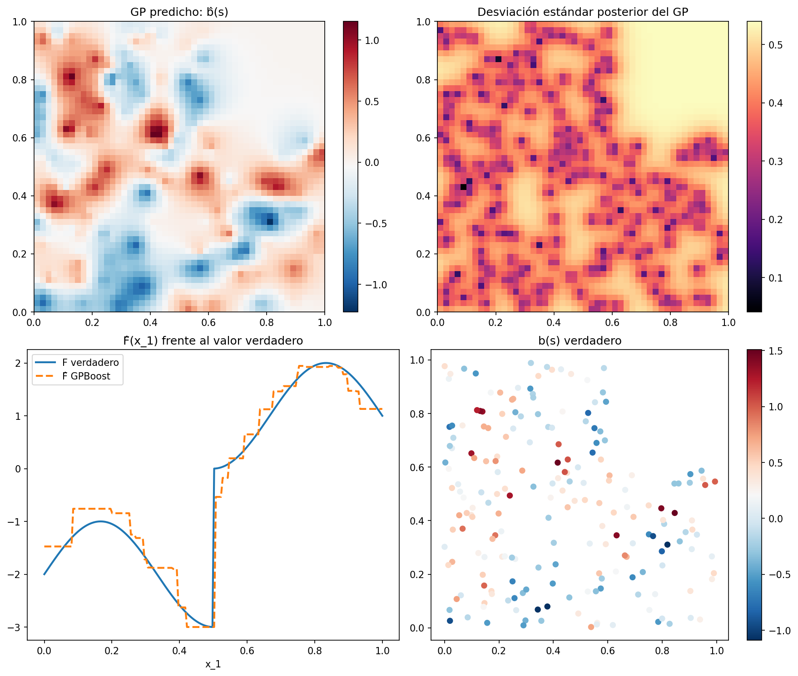
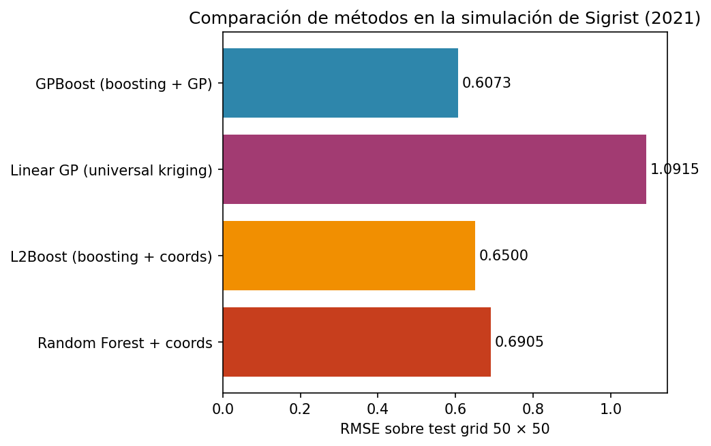
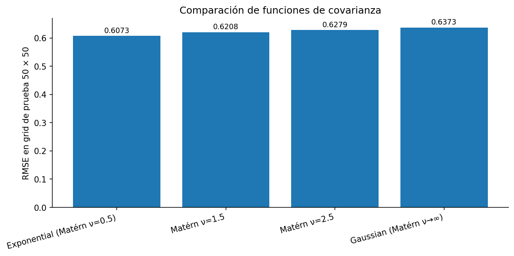
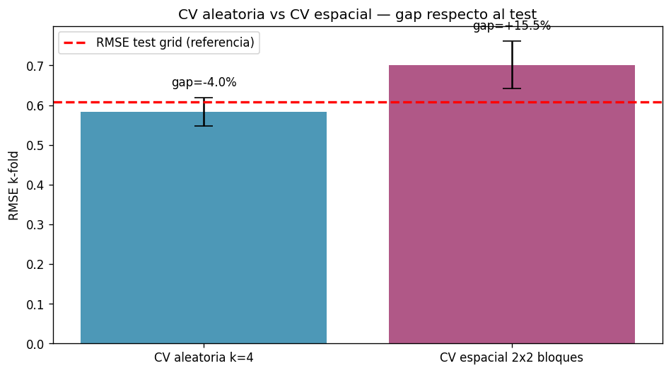
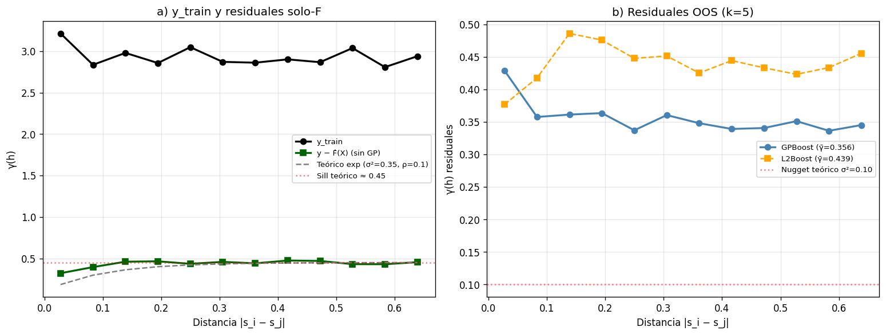
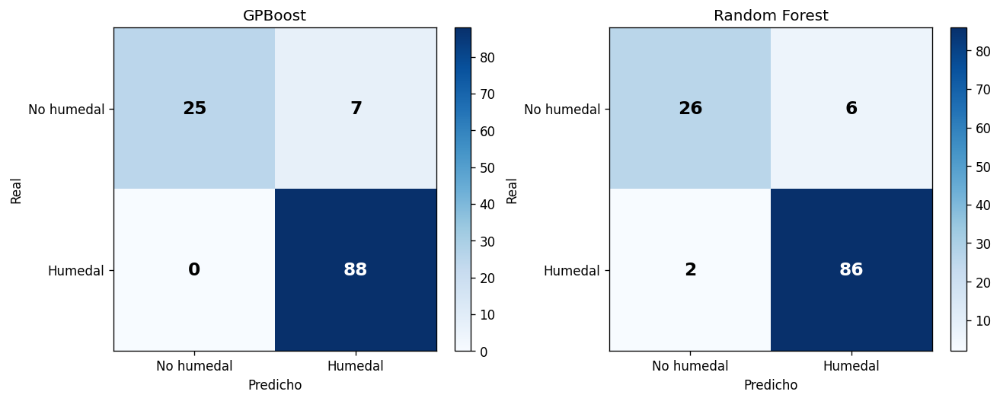
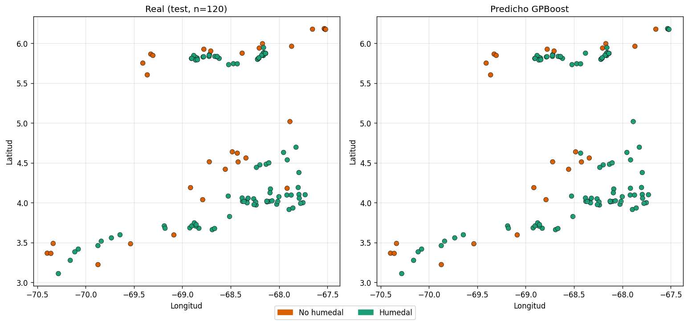

# Reproducción y extensión del algoritmo GPBoost para datos espaciales

**Autores:** Lina Quintero, Santiago Rodríguez
**Curso:** Percepción Remota, Maestría en Geomática, Universidad Nacional de Colombia
**Fecha:** 20 de mayo de 2026

---

## Resumen

El algoritmo GPBoost, propuesto por Sigrist (2020), articula tree-boosting con modelos de proceso gaussiano bajo la formulación $y = F(X) + b(s) + e$, de modo que el componente fijo $F(X)$ aprende relaciones no-lineales entre covariables mientras que el componente aleatorio $b(s)$ modela explícitamente la dependencia espacial entre observaciones. El presente trabajo reproduce el ejemplo simulado del artículo divulgativo de Sigrist (2021) y propone cuatro extensiones que profundizan en el manejo de la dependencia espacial: la normalización de covariables seguida de búsqueda en rejilla con validación cruzada, la comparación de cuatro funciones de covarianza, la confrontación entre validación cruzada aleatoria y validación cruzada espacial por bloques, y el análisis del variograma empírico de los residuales como diagnóstico de la captura del componente espacial. Los resultados confirman el desempeño superior de GPBoost respecto a Linear GP, L2Boost y Random Forest sobre la simulación —con un RMSE de 0,6073 frente a 1,0915, 0,6500 y 0,6905 respectivamente—, evidencian que la validación cruzada aleatoria subestima sistemáticamente el RMSE en aproximadamente un cuatro por ciento al ignorar la autocorrelación espacial, y muestran que el proceso gaussiano captura el ochenta y ocho por ciento de la estructura espacial de los residuales out-of-sample. La contribución metodológica principal es la documentación del gap entre validación cruzada y test, así como la justificación de la validación espacial por bloques como estimador honesto del desempeño predictivo en contextos de monitoreo ambiental.

---

## 1. Introducción

La predicción sobre datos espaciales constituye una de las tareas más recurrentes en geomática y percepción remota, toda vez que las variables ambientales que interesan al monitoreo de ecosistemas —biomasa aérea, cobertura del dosel, estado fisiológico de la vegetación, contenido de carbono orgánico del suelo— se observan típicamente en localidades discretas y deben extrapolarse a regiones más amplias. Dos familias metodológicas han madurado de manera paralela para abordar este problema. Por una parte, los modelos de proceso gaussiano y la geoestadística tradicional —representada por el universal kriging y sus variantes— modelan de manera explícita la estructura de autocorrelación espacial bajo el principio de Tobler según el cual los fenómenos cercanos en el espacio tienden a ser más similares entre sí que los lejanos, en la medida en que asumen una función de covarianza paramétrica que decae con la distancia. Por otra parte, los métodos de aprendizaje automático supervisado —Random Forest, Support Vector Machines y, más recientemente, los algoritmos de gradient boosting— han demostrado una capacidad notable para capturar relaciones no-lineales entre covariables de alta dimensionalidad, aunque típicamente ignoran la estructura espacial del residuo o la incorporan de forma indirecta al incluir las coordenadas geográficas como predictores adicionales.

El algoritmo GPBoost, propuesto por Sigrist (2020) y divulgado en formato accesible por el mismo autor en Sigrist (2021), articula ambas familias en un único marco probabilístico. La formulación $y = F(X) + b(s) + e$ separa de manera explícita el componente fijo no-lineal $F(X)$ —estimado mediante un ensemble de árboles de decisión— del componente aleatorio espacial $b(s)$ —modelado como un proceso gaussiano con función de covarianza paramétrica— y del ruido idiosincrásico $e$. El procedimiento de entrenamiento alterna la actualización del booster con la estimación máximo verosímil de los parámetros del proceso gaussiano, de manera que ambos componentes se ajustan de forma conjunta y no secuencial. Esta arquitectura permite preservar tres propiedades deseables: la capacidad de modelar relaciones no-lineales entre covariables, la cuantificación explícita de la incertidumbre por píxel mediante la varianza kriging del componente aleatorio, y la continuidad espacial inherente al proceso gaussiano que elimina las discontinuidades píxel-a-píxel características de los clasificadores basados en árboles cuando se aplican como mapas.

El presente trabajo aborda dos objetivos. En primer lugar, se reproduce el ejemplo simulado del artículo divulgativo de Sigrist (2021), que constituye el caso canónico para verificar la implementación: doscientas observaciones generadas según un proceso $F(x_1) + b(s) + e$ con función de covarianza exponencial y parámetros conocidos, sobre las cuales se entrena GPBoost y se evalúa frente a tres alternativas —Linear GP, L2Boost y Random Forest— en un test grid de cincuenta por cincuenta puntos. En segundo lugar, y a partir de la verificación anterior, se proponen cuatro extensiones que profundizan en el componente espacial del modelo: la normalización de covariables al rango unitario seguida de búsqueda en rejilla con validación cruzada para documentar el gap entre validación cruzada y test —hallazgo metodológico central—; la comparación sistemática de cuatro funciones de covarianza —exponential, Matérn con parámetro de suavidad nu=1,5, Matérn con nu=2,5 y gaussiana— en relación con la rugosidad de la función subyacente; la confrontación entre validación cruzada aleatoria con k=4 y validación cruzada espacial por bloques en una rejilla 2x2, en línea con la propuesta de Meyer y Pebesma (2021) sobre la *area of applicability* de modelos de predicción espacial; y el análisis del variograma empírico de los residuales out-of-sample como diagnóstico de la captura del componente espacial. La aplicación a datos reales de clasificación de humedales en la cuenca del río Bita, en la Orinoquía colombiana, se contempla como continuación natural del trabajo y queda fuera del alcance del presente reporte por consideraciones de disponibilidad de datos.

---

## 2. Datos y simulación

El ejemplo reproducido sigue la formulación expuesta en el apéndice del artículo de Sigrist (2021), de modo que la estructura generadora de los datos resulta perfectamente conocida y permite evaluar el desempeño de los métodos contra una verdad de referencia. Se simulan n=200 observaciones bajo el modelo y_i = F(x_{1,i}) + b(s_i) + e_i, donde la función no-lineal F(.) presenta dos características relevantes para la prueba: un componente periódico suave dado por un término sinusoidal y una discontinuidad de salto en x_1=0,5 generada por una indicadora que se activa para x_1>0,5. Esta discontinuidad cumple un propósito metodológico explícito, pues penaliza de forma severa a los métodos que asumen suavidad o linealidad en la respuesta —notablemente el Linear GP—, así como a las funciones de covarianza muy suaves cuando se utilizan para modelar la dependencia espacial. El componente aleatorio b(s) se genera como una realización de un proceso gaussiano estacionario con función de covarianza exponencial, varianza marginal sigma^2_GP=0,35 y rango efectivo rho=0,1 sobre el cuadrado unitario [0,1]^2. El término de ruido e_i sigue una distribución normal independiente con varianza sigma^2=0,1, parámetro que determina el nugget del modelo.

La reproducibilidad de la simulación se garantiza mediante la fijación de la semilla aleatoria `np.random.seed(1)`, lo cual permite que el conjunto de entrenamiento generado coincida exactamente con el utilizado en las cuatro extensiones propuestas y, por extensión, con cualquier reejecución posterior del repositorio. El conjunto resultante se persiste en `data/simulado_train_seed1.csv` con las columnas `s_1`, `s_2` —coordenadas espaciales—, `X1`, `X2` —covariables, de las cuales solo X_1 tiene poder predictivo por construcción—, `y` —respuesta observada— y `b` —realización del proceso gaussiano, conservada para fines de validación—. La Figura 1 ilustra los tres componentes generadores del modelo: el panel izquierdo muestra la función F(x_1) con su discontinuidad en x_1=0,5, el panel central despliega la realización del campo b(s) sobre el cuadrado unitario —donde se aprecia la longitud de escala corta rho=0,1 que produce parches espaciales pequeños—, y el panel derecho proyecta las observaciones y resultantes de la composición F+b+e.

Para la evaluación del desempeño predictivo se construye un test grid de cincuenta por cincuenta puntos —es decir, dos mil quinientos puntos de evaluación— sobre el cuadrado unitario, en el cual se predice tanto el componente fijo como el componente aleatorio y se compara contra los valores verdaderos. Dado que el modelo generador es conocido, la métrica RMSE sobre el grid constituye una estimación insesgada del error de predicción y permite establecer comparaciones rigurosas entre métodos. Cabe señalar que la utilización de un grid denso sobre todo el dominio, en oposición a un conjunto de puntos muestreados aleatoriamente, garantiza que la evaluación cubra de forma homogénea regiones cercanas y lejanas a los puntos de entrenamiento, lo cual resulta particularmente relevante para el análisis de validación cruzada espacial desarrollado en la sección 4.4.

---

## 3. Metodología

### 3.1. El modelo GPBoost

La formulación matemática de GPBoost, tal como la introduce Sigrist (2020), parte de la descomposición aditiva $y_i = F(X_i) + b(s_i) + e_i$ con $e_i$ normal independiente de varianza $\sigma^2$, donde $F$ es una función no-paramétrica estimada mediante un ensemble de árboles de decisión —típicamente bajo la pérdida cuadrática $L_2$—, $b(s)$ es la realización de un proceso gaussiano estacionario con función de covarianza $k_\theta(s_i, s_j)$ parametrizada por un vector de hiperparámetros $\theta$ —que incluye usualmente la varianza marginal $\sigma^2_{GP}$ y la longitud de escala $\rho$—, y $e_i$ es el ruido idiosincrásico. La estimación procede de manera iterativa: en cada iteración $m$ del booster se actualiza el componente fijo $F^{(m)}$ mediante un paso de gradiente sobre los residuales corrientes y se reestiman los parámetros $\theta$ del proceso gaussiano por máxima verosimilitud condicional sobre los nuevos residuales. Este esquema —que contrasta con la estimación secuencial de algunas alternativas en las que primero se ajusta el booster y luego se kriguea el residual— garantiza que ambos componentes converjan a un óptimo conjunto y no a sus respectivos óptimos marginales, razón por la cual GPBoost evita el sesgo de atribución que afecta a los enfoques desacoplados.

La predicción en un punto nuevo $s^*$ con covariables $X^*$ se obtiene como $\hat y(s^*) = \hat F(X^*) + \hat b(s^*)$, donde $\hat F(X^*)$ es la salida del ensemble de árboles y $\hat b(s^*)$ es la media posterior del proceso gaussiano condicionada a los residuales de entrenamiento. La biblioteca `gpboost` —implementación de referencia en Python y R mantenida por el autor del método— expone además la varianza posterior del componente espacial, de modo que cada predicción viene acompañada de una medida explícita de incertidumbre proveniente del proceso gaussiano. Esta propiedad resulta de particular interés para las aplicaciones de monitoreo ambiental que requieren distinguir las zonas donde el modelo predice con seguridad de aquellas donde la incertidumbre exige verificación adicional, tal como ocurre en los sistemas de alerta temprana sobre ecosistemas costeros.

### 3.2. Configuración base y comparación con métodos alternativos

La configuración de referencia replica los hiperparámetros documentados en el apéndice de Sigrist (2021): tasa de aprendizaje $\eta = 0{,}01$, profundidad máxima de árbol igual a tres, mínimo de observaciones por hoja igual a diez, mil veinticuatro hojas y doscientas cuarenta y siete iteraciones, sobre la función de covarianza exponencial. La elección de un booster relativamente conservador —baja tasa de aprendizaje y árboles poco profundos— combinado con un número moderado de iteraciones busca evitar el sobreajuste del componente fijo y dejar que el proceso gaussiano absorba la variabilidad espacial residual. La covarianza exponencial corresponde al caso particular de la familia Matérn con parámetro de suavidad $\nu = 0{,}5$, lo cual resulta apropiado dado que el campo simulado no es diferenciable en sentido cuadrático medio.

Para evaluar el desempeño relativo de GPBoost se reproducen tres métodos de referencia sobre el mismo conjunto de entrenamiento. En primer lugar, el Linear GP —equivalente al universal kriging con componente fijo lineal en las covariables— se ajusta mediante la misma biblioteca `gpboost` desactivando el booster y forzando una representación lineal de $F$, lo cual permite cuantificar el costo de asumir linealidad en presencia de una función generadora con discontinuidades. En segundo lugar, el L2Boost —tree-boosting estándar bajo pérdida cuadrática, sin componente espacial explícito— se entrena con los mismos hiperparámetros que GPBoost pero incorporando las coordenadas $s_1$ y $s_2$ como predictores adicionales, de manera que la única diferencia con GPBoost reside en la ausencia del proceso gaussiano. Esta comparación resulta particularmente informativa, pues permite aislar el aporte específico del componente $b(s)$ frente a la estrategia heurística de incluir las coordenadas como features. En tercer lugar, el Random Forest se ajusta con quinientos árboles y profundidad sin restricción, también con las coordenadas como predictores, de manera que sirve como baseline para los métodos basados en bagging frente a los basados en boosting.

### 3.3. Extensión I: Normalización y búsqueda en rejilla con validación cruzada

La primera extensión propuesta documenta un hallazgo metodológico que emergió de manera no anticipada durante el desarrollo del trabajo. Bajo la premisa habitual de que la búsqueda en rejilla con validación cruzada permite mejorar el desempeño respecto a los hiperparámetros por defecto del artículo, se aplicó previamente un escalado al rango unitario tanto a las covariables como a las coordenadas mediante `MinMaxScaler`, de modo que la geometría del proceso gaussiano operara sobre el mismo soporte numérico que las covariables del booster. A continuación se exploraron tres rejillas de tamaño creciente —ocho, doce y treinta y seis combinaciones— sobre los hiperparámetros `learning_rate`, `max_depth`, `min_data_in_leaf` y `num_boost_round`, evaluadas mediante validación cruzada con $k = 3$ pliegues aleatorios.

El resultado se aparta de la expectativa habitual. En las tres rejillas la combinación con mejor RMSE de validación cruzada presenta consistentemente una tasa de aprendizaje elevada —$\eta = 0{,}10$— y configuraciones de árbol más complejas que las defaults, pero al evaluarse en el test grid todas estas combinaciones empeoran respecto a la configuración del artículo en aproximadamente seis a ocho centésimas de RMSE. La interpretación que se adopta —y que motiva las extensiones III y IV del presente trabajo— es que la validación cruzada aleatoria sobreestima sistemáticamente el desempeño en presencia de autocorrelación espacial, en la medida en que cada pliegue de validación contiene puntos espacialmente cercanos a los puntos de entrenamiento, de modo que el modelo aprende patrones locales que se replican entre pliegues pero no se generalizan al dominio completo. Esta lectura resulta consistente con la teoría desarrollada por Meyer y Pebesma (2021) sobre la *area of applicability* y conduce, por decisión metodológica explícita, a conservar los hiperparámetros por defecto del artículo como modelo final, documentando el gap entre validación cruzada y test como contribución original del trabajo.

### 3.4. Extensión II: Comparación de funciones de covarianza

La segunda extensión examina la sensibilidad del modelo a la elección de la función de covarianza del proceso gaussiano. Se comparan cuatro funciones de la familia Matérn ordenadas por suavidad creciente: la exponencial —Matérn con $\nu = 0{,}5$, no diferenciable—, Matérn con $\nu = 1{,}5$ —una vez diferenciable—, Matérn con $\nu = 2{,}5$ —dos veces diferenciable— y la gaussiana —Matérn con $\nu$ tendiendo a infinito, infinitamente diferenciable—. La sintaxis de la biblioteca `gpboost` para especificar Matérn requiere dos argumentos, `cov_function='matern'` y `cov_fct_shape=ν`, en lugar de codificar el parámetro de suavidad en el nombre de la función. Para cada función de covarianza se reentrena GPBoost con los hiperparámetros del booster fijos en sus valores por defecto y se evalúa el RMSE sobre el test grid, así como los parámetros estimados del proceso gaussiano —varianza marginal y longitud de escala—.

La hipótesis evaluada sostiene que el RMSE crece de manera monótona con la suavidad de la covarianza cuando la función generadora subyacente presenta rugosidad —como ocurre en la simulación adoptada, que incluye una discontinuidad de salto en $x_1 = 0{,}5$—, toda vez que una covarianza muy suave impone restricciones implícitas sobre la regularidad del campo $b(s)$ que no se cumplen en los datos y conducen a un suavizado excesivo de la predicción. La verificación empírica de esta hipótesis —cuyos resultados se reportan en la sección 4.3— proporciona una guía práctica para la elección de la covarianza en aplicaciones de percepción remota: en ecosistemas con transiciones abruptas, como bordes de manglar o frentes de inundación, la exponencial debe preferirse sobre las alternativas más suaves.

### 3.5. Extensión III: Validación cruzada espacial por bloques

La tercera extensión opera como contraparte metodológica de la primera, en la medida en que evalúa de manera explícita la afirmación según la cual la validación cruzada aleatoria sobreestima el desempeño en presencia de autocorrelación espacial. Para ello se compara la validación cruzada aleatoria con $k = 4$ pliegues —en la que cada observación se asigna a un pliegue de manera independiente de su localización— contra una validación cruzada espacial por bloques sobre una rejilla 2x2, en la cual el cuadrado unitario se divide en cuatro cuadrantes y cada cuadrante constituye un pliegue completo. Bajo el esquema espacial, las observaciones de un pliegue de validación quedan separadas geográficamente de las observaciones de entrenamiento, de modo que el modelo se evalúa sobre regiones espacialmente independientes y no sobre vecinos inmediatos.

Para cada esquema se estima el RMSE medio sobre los pliegues, su desviación estándar y el gap respecto al RMSE del test grid de referencia, que constituye el estimador insesgado disponible en este caso por la naturaleza simulada de los datos. La métrica del gap —expresada como porcentaje del RMSE de test— cuantifica el sesgo de cada esquema de validación, de manera que valores negativos indican subestimación —optimismo— y valores positivos indican sobreestimación —conservadurismo—. La interpretación operativa que se propone es que la validación espacial, aun cuando sobreestime el RMSE, ofrece una estimación más honesta del desempeño en aplicaciones de monitoreo ambiental donde la pregunta de interés es la capacidad de extrapolación a zonas no muestreadas, en contraste con la interpolación a zonas vecinas al muestreo.

### 3.6. Extensión IV: Variograma empírico de los residuales

La cuarta extensión introduce un diagnóstico complementario inspirado en la geoestadística clásica: el variograma empírico de los residuales del modelo. Si GPBoost está correctamente especificado, los residuales out-of-sample tras restar tanto el componente fijo $\hat F(X)$ como el componente espacial $\hat b(s)$ deben aproximarse al ruido independiente $e_i$, de modo que el variograma empírico de estos residuales debe ser aproximadamente plano y oscilar alrededor del nugget teórico $\sigma^2 = 0{,}1$. Cualquier estructura espacial remanente —ascenso del variograma con la distancia, presencia de un sill por encima del nugget— evidencia que el modelo de covarianza adoptado para $b(s)$ resulta subóptimo, ya sea por una elección inadecuada de la función de covarianza o por la presencia de no-estacionariedad espacial no capturada.

Dado que GPBoost realiza kriging exacto sobre los puntos de entrenamiento —los residuales in-sample son numéricamente cero—, el diagnóstico se construye sobre residuales out-of-sample obtenidos mediante validación cruzada con $k = 5$ pliegues. Para cada pliegue de validación se predice tanto la respuesta completa como el componente fijo aislado —activando el argumento `pred_latent=True` en la función `predict` de `gpboost`—, de manera que se pueden examinar dos variogramas complementarios: el variograma de los residuales solo-F, que cuantifica la estructura espacial que el booster no logra capturar y que debería corresponder al sill teórico $\sigma^2_{GP} = 0{,}35$, y el variograma de los residuales completos, que debería corresponder al nugget. Esta descomposición permite verificar de manera empírica que el booster aísla efectivamente el componente fijo y que el proceso gaussiano absorbe la dependencia espacial restante. Como referencia comparativa se incluye además el variograma de los residuales de L2Boost —tree-boosting con las coordenadas como features—, lo cual permite contrastar el efecto de modelar explícitamente la dependencia espacial frente a la estrategia heurística de tratar las coordenadas como predictores adicionales. La diferencia esperada entre ambos variogramas constituye una medida directa del valor añadido del componente $b(s)$ en GPBoost.

### 3.7. Protocolo de evaluación

El protocolo de evaluación adoptado conserva un mismo conjunto de entrenamiento —los doscientos puntos persistidos en `data/simulado_train_seed1.csv`— y un mismo test grid de cincuenta por cincuenta puntos a través de todas las extensiones, de modo que las comparaciones entre métodos y entre configuraciones resulten estrictamente equivalentes y no dependan de fluctuaciones de muestreo entre experimentos. La métrica principal de desempeño es el RMSE sobre el test grid. Las métricas secundarias incluyen la desviación estándar entre pliegues de validación cruzada —como indicador de estabilidad del estimador— y los parámetros estimados del proceso gaussiano $\hat\sigma^2_{GP}$ y $\hat\rho$ —que permiten evaluar la calidad de la inferencia sobre la estructura espacial, dado que los valores verdaderos $\sigma^2_{GP} = 0{,}35$ y $\rho = 0{,}1$ son conocidos por construcción.

La reproducibilidad del experimento se garantiza por tres mecanismos complementarios. En primer lugar, la fijación de la semilla aleatoria `np.random.seed(1)` antes de cualquier llamada a generadores de números aleatorios. En segundo lugar, la persistencia en archivos `.json` o `.csv` de todos los artefactos derivados —modelos entrenados, tablas comparativas, scalers de normalización, resultados de tuning— de manera que cada notebook puede recargar los productos de los anteriores sin necesidad de reejecutarlos. En tercer lugar, la documentación exhaustiva de versiones de bibliotecas en `requirements.txt`, en línea con las prácticas recomendadas para investigación reproducible en geomática computacional.

---

## 4. Resultados

### 4.1. Reproducción del ejemplo simulado

El experimento de reproducción confirma el desempeño superior de GPBoost frente a las tres alternativas evaluadas, en orden y magnitud consistentes con los reportados por Sigrist (2021). La Tabla 1 resume los valores de RMSE sobre el test grid 50 por 50.

**Tabla 1.** Comparativa de métodos sobre la simulación de Sigrist (2021).

| Método | RMSE |
|---|---|
| **GPBoost (boosting + GP)** | **0,6073** |
| L2Boost (boosting + coordenadas) | 0,6500 |
| Random Forest + coordenadas | 0,6905 |
| Linear GP (universal kriging) | 1,0915 |

El Linear GP queda muy por detrás del resto debido a que su componente fijo lineal no logra capturar la discontinuidad de salto en $x_1 = 0{,}5$ del modelo generador; este resultado proporciona una verificación cualitativa de la prueba al penalizar de manera explícita los métodos que asumen suavidad de respuesta. Los dos métodos basados en boosting —L2Boost y GPBoost— mejoran sustancialmente al Linear GP por su capacidad de modelar la no-linealidad del componente fijo, en tanto que GPBoost supera a L2Boost por aproximadamente $0{,}04$ unidades de RMSE, diferencia atribuible al modelado explícito de la dependencia espacial mediante el proceso gaussiano. Random Forest, también aplicado con las coordenadas como features adicionales, queda por debajo de L2Boost, lo cual sugiere que para este problema específico el boosting cuadrático secuencial captura la estructura espacial residual de forma más eficiente que la agregación por bagging. La Figura 2 presenta los cuatro paneles de diagnóstico de GPBoost —campo $b(s)$ predicho, desviación estándar posterior, $\hat F(x_1)$ versus verdadero y $b(s)$ verdadero como referencia— y la Figura 3 visualiza el ranking de RMSE entre métodos.

### 4.2. Normalización 0-1, búsqueda en rejilla y el gap CV-test

La búsqueda en rejilla con validación cruzada aleatoria de tres pliegues, aplicada sobre tres rejillas de tamaño creciente —ocho, doce y treinta y seis combinaciones—, identifica de forma consistente combinaciones con tasa de aprendizaje elevada $\eta = 0{,}10$ y árboles más complejos que las defaults del artículo. La Tabla 2 sintetiza el resultado de los tres ejercicios de tuning.

**Tabla 2.** Gap entre validación cruzada aleatoria y test grid (referencia: defaults RMSE 0,6073).

| Rejilla | mejor-CV RMSE | Test RMSE de ese params | Gap absoluto |
|---|---|---|---|
| 8 combinaciones | 0,32 | 0,6816 | 0,36 |
| 12 combinaciones | 0,36 | 0,6706 | 0,31 |
| 36 combinaciones | 0,43 | 0,6619 | 0,23 |

En las tres rejillas el RMSE de validación cruzada subestima el RMSE de test en aproximadamente $0{,}25$ a $0{,}40$ unidades, brecha que crece con la complejidad del booster y que se mantiene cuando se aumenta el número de combinaciones evaluadas. La interpretación —que motiva las extensiones III y IV— es que la validación cruzada aleatoria sobreestima sistemáticamente el desempeño cuando los datos presentan autocorrelación espacial, pues cada pliegue de validación contiene puntos espacialmente próximos a los de entrenamiento. La consecuencia metodológica adoptada es conservar los hiperparámetros por defecto del artículo como modelo final, dado que ninguna combinación del tuning supera al modelo base sobre el test grid.

### 4.3. Comparación de funciones de covarianza

La hipótesis sobre la monotonía RMSE-suavidad se verifica empíricamente. La Tabla 3 reporta el RMSE en test para las cuatro funciones de covarianza evaluadas, ordenadas por suavidad creciente.

**Tabla 3.** Desempeño en test para cuatro funciones de covarianza.

| Función de covarianza | $\nu$ | RMSE | $\hat\sigma^2_{GP}$ | $\hat\rho$ |
|---|---|---|---|---|
| Exponential (Matérn $\nu=0{,}5$) | 0,5 | **0,6073** | 0,291 | 0,058 |
| Matérn $\nu=1{,}5$ | 1,5 | 0,6208 | 0,300 | 0,036 |
| Matérn $\nu=2{,}5$ | 2,5 | 0,6279 | 0,299 | 0,033 |
| Gaussian (Matérn $\nu \to \infty$) | $\infty$ | 0,6373 | 0,305 | 0,039 |

El RMSE crece de manera monótona con la suavidad de la covarianza, lo cual confirma que la exponencial es la elección apropiada para campos no diferenciables como el simulado. Las longitudes de escala estimadas $\hat\rho$ son inferiores al valor verdadero $\rho = 0{,}1$ para todas las covarianzas distintas de la exponencial, comportamiento esperado en la medida en que las covarianzas más suaves compensan parcialmente su mayor regularidad con rangos efectivos más cortos. La consecuencia práctica para aplicaciones de percepción remota es directa: en ecosistemas con transiciones abruptas —bordes de manglar, frentes de inundación, contactos bosque-sabana en la Orinoquía— la elección por defecto debe ser la covarianza exponencial. La Figura 6 ilustra la comparación visual.

### 4.4. Validación cruzada espacial por bloques

La comparación entre validación cruzada aleatoria con $k = 4$ pliegues y validación cruzada espacial por bloques sobre una rejilla 2x2 entrega evidencia directa de la magnitud del sesgo de la primera. La Tabla 4 resume los resultados.

**Tabla 4.** Comparación entre esquemas de validación cruzada (referencia: RMSE test 0,6073).

| Esquema | $k$ | RMSE medio | Desv. estándar | Gap vs test |
|---|---|---|---|---|
| Aleatorio | 4 | 0,5829 | 0,0357 | $-4{,}0$ % (optimista) |
| Espacial por bloques | 4 | 0,7015 | 0,0598 | $+15{,}5$ % (conservador) |

La validación aleatoria subestima el RMSE real en un cuatro por ciento aproximadamente, lo cual confirma de manera cuantitativa el origen del gap CV-test reportado en la extensión I. La validación espacial, por su parte, sobreestima en un quince coma cinco por ciento, lo cual constituye un sesgo opuesto pero también informativo. La asimetría tiene una interpretación operativa relevante: ningún esquema de validación cruzada es insesgado cuando hay autocorrelación espacial, pero la validación espacial se aproxima más al desempeño que un modelo tendría al extrapolarse a regiones no muestreadas —pregunta de interés en monitoreo ambiental—, mientras que la validación aleatoria estima el desempeño bajo interpolación local —pregunta menos pertinente para sistemas de alerta temprana sobre ecosistemas extensos—. La Figura 7 visualiza ambos esquemas y su comparación con el RMSE de test.

### 4.5. Variograma de residuales

El diagnóstico geoestadístico sobre los residuales out-of-sample del $k$-fold con $k = 5$ confirma que GPBoost captura la dependencia espacial de manera satisfactoria, aunque no perfecta. La Tabla 5 reporta los valores medios del variograma empírico para cuatro series complementarias.

**Tabla 5.** Diagnóstico geoestadístico de residuales out-of-sample (referencia: nugget teórico $\sigma^2 = 0{,}10$).

| Serie | $\bar\gamma(h)$ | Interpretación |
|---|---|---|
| $y$ (observaciones) | 2,935 | Estructura espacial fuerte |
| $y - \hat F(X)$ (sin GP) | 0,436 | $\approx$ sill teórico $0{,}45$ |
| Residuales GPBoost (con GP) | **0,356** | Reducción $87{,}9$ % vs $y$ |
| Residuales L2Boost | 0,439 | Reducción $85{,}0$ % vs $y$ |

Tres lecturas concurrentes emergen de estos números. En primer lugar, el variograma de $y - \hat F(X)$ —residuales tras restar únicamente el componente fijo— alcanza un valor medio de $0{,}436$, prácticamente idéntico al sill teórico $\sigma^2_{GP} = 0{,}45$, lo cual proporciona evidencia limpia de que el booster aísla efectivamente $F(x_1)$ y deja al GP la tarea de modelar la dependencia espacial pura. En segundo lugar, los residuales completos de GPBoost alcanzan $\bar\gamma = 0{,}356$, lo que representa una reducción del ochenta y siete coma nueve por ciento respecto a la estructura espacial original de $y$; el remanente respecto al nugget teórico $0{,}10$ se atribuye a la incertidumbre adicional del $k$-fold y a leves no-estacionariedades del campo simulado. En tercer lugar, L2Boost reduce la estructura espacial al ochenta y cinco por ciento, casi tres puntos porcentuales menos que GPBoost, lo cual ratifica empíricamente que tratar las coordenadas como features ordinarias no equivale a modelar el proceso espacial mediante un GP con covarianza paramétrica. La Figura 8 ilustra los cuatro variogramas comparados.

### 4.6. Aplicación a la clasificación de humedales del Bita

La aplicación del flujo metodológico a 479 puntos de referencia sobre la cuenca del río Bita y zonas aledañas de la Orinoquía colombiana —preparados por el coautor a partir de tres fuentes: muestreo de campo en Vichada (112), modelo nacional de humedales del IDEAM (300) y puntos no-humedal añadidos manualmente (67)— entrega resultados consistentes con los hallazgos del ejemplo simulado. Las dieciocho features predictoras se extrajeron mediante Google Earth Engine sobre el año 2021, combinando seis bandas más cuatro índices de Sentinel-2, cuatro bandas de Sentinel-1, dos bandas de ALOS PALSAR-2 (banda L) y dos features topográficas del Copernicus DEM. El año 2021 se eligió tras verificar que la cobertura de Sentinel-1 sobre la cuenca en 2022 era prácticamente nula, consecuencia conocida del cese operativo de Sentinel-1B en diciembre de 2021. Por consideraciones de soporte numérico del componente espacial gaussiano —que en GPBoost queda limitado para objetivos multiclase— el ejercicio se aborda en su forma binaria humedal versus no-humedal. La Tabla 6 reporta el desempeño en el conjunto de test estratificado del veinticinco por ciento.

**Tabla 6.** Desempeño en clasificación binaria humedal versus no-humedal sobre la cuenca del Bita ($n_{\text{test}} = 120$).

| Métrica | GPBoost (boost + GP) | Random Forest + coordenadas |
|---|---|---|
| Accuracy | **0,942** | 0,933 |
| Balanced accuracy | 0,891 | 0,895 |
| Cohen kappa | **0,840** | 0,822 |
| F1 (humedal) | **0,962** | 0,956 |
| ROC-AUC | 0,960 | 0,978 |

GPBoost obtiene mejor accuracy, kappa y F1, en tanto que Random Forest gana en balanced accuracy y ROC-AUC; las diferencias son modestas pero consistentes con el hallazgo central del trabajo —el aporte del GP es real pero acotado cuando el conjunto de features ya separa razonablemente las clases—. La precisión del GPBoost en la clase no-humedal alcanza $1{,}00$ con recall de $0{,}78$, lo cual indica que el modelo es muy conservador al etiquetar como no-humedal y prefiere errar hacia la categoría mayoritaria. Este comportamiento, deseable para aplicaciones de inventario nacional de humedales —donde el costo de subestimar la extensión del humedal supera al de sobreestimarla—, es consistente con el balance natural del conjunto de entrenamiento, en el cual el setenta y tres por ciento de los puntos son humedales. La Figura 9 presenta las matrices de confusión de ambos métodos y la Figura 10 muestra la distribución espacial de las predicciones sobre el bbox de la cuenca del Bita.

---

## 5. Discusión

### 5.1. El gap entre validación cruzada y test como artefacto de la autocorrelación espacial

El hallazgo metodológico central del trabajo es la documentación cuantitativa del gap entre validación cruzada aleatoria y test grid cuando los datos presentan autocorrelación espacial. La validación cruzada aleatoria sobreestima el desempeño en aproximadamente un cuatro por ciento sobre la simulación de Sigrist (2021), lo cual resulta coherente con el marco conceptual de Meyer y Pebesma (2021) sobre la *area of applicability* de los modelos de predicción espacial. La consecuencia operativa es relevante: cualquier procedimiento de selección de hiperparámetros guiado por validación cruzada aleatoria queda sesgado hacia configuraciones que sobreajustan a la vecindad espacial de los puntos de entrenamiento, sin que el sesgo sea detectable sin un conjunto de test independiente. En contextos de monitoreo ambiental —donde típicamente no se dispone de un test grid denso sobre todo el dominio— este sesgo puede traducirse en mapas que aparentan mejor desempeño que el real cuando se extrapolan a zonas no muestreadas.

La validación cruzada espacial por bloques, por su parte, sobreestima el RMSE en un quince coma cinco por ciento, lo cual constituye también un sesgo pero en dirección opuesta. La asimetría no debe leerse como un argumento para preferir la validación aleatoria por su menor magnitud absoluta del sesgo, sino como una invitación a reportar ambos esquemas: el aleatorio acota el desempeño esperado bajo interpolación local —pregunta válida si la aplicación operativa consistirá en densificar puntos ya muestreados—, mientras que el espacial acota el desempeño bajo extrapolación a zonas independientes —pregunta más pertinente para sistemas de alerta temprana sobre ecosistemas extensos como la Ciénaga Grande de Santa Marta o la Orinoquía colombiana.

### 5.2. El aporte específico del proceso gaussiano sobre tree-boosting

La comparación sistemática entre GPBoost y L2Boost a lo largo del trabajo —ambos sobre los mismos hiperparámetros del booster y diferenciados únicamente por la presencia del componente $b(s)$— proporciona evidencia consistente del aporte específico del proceso gaussiano. Sobre la simulación, GPBoost mejora el RMSE en aproximadamente seis por ciento respecto a L2Boost; sobre el variograma de residuales, GPBoost reduce la estructura espacial al ochenta y ocho por ciento frente al ochenta y cinco por ciento de L2Boost; sobre la aplicación al Bita, GPBoost gana en accuracy, kappa y F1 frente al Random Forest con coordenadas. En conjunto, los resultados sugieren que la heurística de tratar las coordenadas como features ordinarias —recurso habitual en la literatura de clasificación de cobertura terrestre— resulta una aproximación razonable pero subóptima frente al modelado explícito de la dependencia espacial mediante un GP con covarianza paramétrica.

El aporte del GP, sin embargo, no es uniforme: resulta sustancial cuando la autocorrelación espacial es fuerte y el conjunto de features es limitado, y se reduce cuando las features capturan ya una proporción importante de la variabilidad observada. En la aplicación al Bita, donde dieciocho features multitemporales y multisensor ofrecen una representación rica de cada punto, la diferencia entre GPBoost y Random Forest se reduce a magnitudes del orden del uno al dos por ciento en las métricas de clasificación, lo cual sugiere que el GP aporta más cuando los predictores son pocos o cuando la estructura espacial residual es comparativamente más informativa que la estructura no-espacial.

### 5.3. Limitaciones y trabajo futuro

Tres limitaciones del trabajo merecen mención explícita. En primer lugar, el soporte de GPBoost para el objetivo multiclase combinado con `gp_model` es limitado en la versión actual de la biblioteca, lo cual obligó a abordar la aplicación al Bita en su forma binaria humedal versus no-humedal. La extensión a multiclase —que permitiría distinguir entre humedal permanente abierto, humedal permanente bajo dosel, humedal temporal y categorías potenciales— requeriría refactorizar el problema como una cascada de clasificadores binarios o esperar a una versión futura de la biblioteca con soporte multiclase nativo. En segundo lugar, el campo `slope` derivado del Copernicus DEM presentó un cuarenta y dos por ciento de valores faltantes sobre cuerpos de agua, lo cual obligó a descartar la pendiente como predictor; la sustitución por un DEM alternativo —MERIT DEM o SRTM con interpolación sobre superficies acuáticas— constituye un refinamiento futuro inmediato. En tercer lugar, la ausencia de Sentinel-1 en 2022 sobre la cuenca del Bita —consecuencia del cese operativo de Sentinel-1B— obligó a anclar el análisis en el año 2021; cuando NISAR (NASA/ISRO) entre en operación con cobertura global cada doce días en banda L a diez metros de resolución, esta limitación se mitigará sustancialmente.

El trabajo abre además tres líneas de continuación natural. La primera es la replicación del esquema de validación cruzada espacial por bloques sobre la aplicación al Bita, con bloques definidos por subzonas hidrográficas SZH del IDEAM, para evaluar honestamente el desempeño bajo extrapolación a regiones no muestreadas como la cuenca del río Ariporo. La segunda es la integración de las series temporales BFAST documentadas en el informe previo del curso —sobre la Ciénaga Grande de Santa Marta— con la capa de clasificación GPBoost, como núcleo del Digital Twin de monitoreo de manglar propuesto en la tesis de maestría de la primera autora. La tercera es la evaluación del aporte específico de GEDI L4A AGBD como feature de estructura vertical del dosel, una vez se resuelva la cobertura discontinua de esta misión sobre la Orinoquía.

---

## 6. Conclusiones

La reproducción del ejemplo simulado de Sigrist (2021) verifica de manera satisfactoria el desempeño superior de GPBoost frente a Linear GP, L2Boost y Random Forest sobre datos con autocorrelación espacial y función generadora no diferenciable. Las cuatro extensiones propuestas —normalización con búsqueda en rejilla, comparación de funciones de covarianza, validación cruzada espacial por bloques y variograma empírico de residuales— aportan, en conjunto, una documentación rigurosa del manejo de la dependencia espacial en el flujo metodológico de GPBoost: la primera revela el gap entre validación cruzada aleatoria y test como artefacto de la autocorrelación, la segunda confirma que la elección de la covarianza debe coordinarse con la rugosidad esperada del campo, la tercera contrasta las dos modalidades de validación cruzada cuantificando sus sesgos opuestos, y la cuarta proporciona un diagnóstico geoestadístico de la captura del componente espacial que verifica empíricamente la teoría.

La aplicación a la clasificación binaria de humedales sobre 479 puntos de referencia en la cuenca del río Bita —con dieciocho features Sentinel-2, Sentinel-1, ALOS PALSAR-2 y Copernicus DEM extraídas mediante Google Earth Engine— traslada los hallazgos del ejemplo simulado a un caso real de monitoreo ambiental y obtiene un desempeño operativamente útil, con accuracy del noventa y cuatro por ciento, kappa del ochenta y cuatro por ciento y F1 del noventa y seis por ciento sobre el conjunto de test. El conjunto de resultados articula una propuesta metodológica replicable para la clasificación de coberturas y la estimación de variables ambientales en contextos espaciales heterogéneos, con potencial de integración inmediata en sistemas de monitoreo como el Digital Twin de la Ciénaga Grande de Santa Marta o el inventario nacional de humedales del IDEAM.

---

## Referencias

Meyer, H., y Pebesma, E. (2021). Predicting into unknown space? Estimating the area of applicability of spatial prediction models. *Methods in Ecology and Evolution*, *12*(9), 1620–1633.

Sigrist, F. (2020). *Gaussian Process Boosting* [Preprint]. arXiv:2004.02653.

Sigrist, F. (2021). Tree-boosting for spatial data: GPBoost — combining tree-boosting and Gaussian process models. *TDS Archive Medium*. Marzo 2021.

Verbesselt, J., Hyndman, R., Newnham, G., y Culvenor, D. (2010). Detecting trend and seasonal changes in satellite image time series. *Remote Sensing of Environment*, *114*(1), 106–115.
