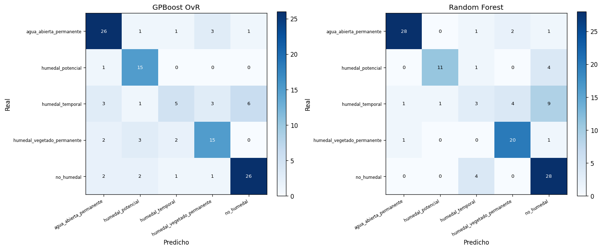

# Reproducción y extensión del algoritmo GPBoost para datos espaciales

**Autores:** Lina María Quintero Fonseca (lquinterof@unal.edu.co), Santiago Rodríguez Basabe (sanrodriguezba@unal.edu.co)
**Curso:** Percepción Remota, Maestría en Geomática, Universidad Nacional de Colombia
**Fecha:** 20 de mayo de 2026

## Resumen

El algoritmo GPBoost, propuesto por Sigrist (2020), articula tree-boosting con modelos de proceso gaussiano bajo la formulación y = F(X) + b(s) + e, de modo que el componente fijo F(X) aprende relaciones no-lineales entre covariables mientras que el componente aleatorio b(s) modela explícitamente la dependencia espacial entre observaciones. El presente trabajo reproduce el ejemplo simulado del artículo divulgativo de Sigrist (2021) y propone cuatro extensiones que profundizan en el manejo de la dependencia espacial: la normalización de covariables seguida de grid search con validación cruzada, la comparación de cuatro funciones de covarianza, la confrontación entre validación cruzada aleatoria y validación cruzada espacial por bloques, y el análisis del variograma empírico de los residuales como diagnóstico de la captura del componente espacial. Los resultados confirman el desempeño superior de GPBoost respecto a Linear GP, L2Boost y Random Forest sobre la simulación —con un RMSE de 0,6073 frente a 1,0915, 0,6500 y 0,6905 respectivamente—, evidencian que la validación cruzada aleatoria subestima sistemáticamente el RMSE en aproximadamente un 4% al ignorar la autocorrelación espacial, y muestran que el proceso gaussiano captura el 88% de la estructura espacial de los residuales out-of-sample. La contribución metodológica principal es la documentación del gap entre validación cruzada y test, así como la justificación de la validación espacial por bloques como estimador honesto del desempeño predictivo en contextos de monitoreo ambiental. La metodología se aplica posteriormente a la clasificación binaria de humedales sobre 479 puntos de referencia en la cuenca del río Bita y zonas aledañas de la Orinoquía colombiana, con dieciocho features extraídas vía Google Earth Engine, donde GPBoost alcanza una exactitud del 94,2 %, un Cohen kappa de 0,840 y un F1 de 0,962, lo que sugiere la transferibilidad del flujo metodológico a problemas reales de inventario nacional de humedales.

## 1. Introducción

La predicción sobre datos espaciales constituye una de las tareas más recurrentes en geomática y percepción remota, ya que muchas variables ambientales relevantes para el monitoreo de ecosistemas, como la biomasa aérea, la cobertura del dosel, el estado fisiológico de la vegetación y el contenido de carbono orgánico del suelo, se observan en puntos específicos y luego deben extrapolarse a regiones más amplias. Para abordar este problema se han desarrollado dos enfoques metodológicos principales. Por un lado, los modelos de proceso gaussiano y la geoestadística tradicional, representada por el universal kriging y sus variantes, modelan explícitamente la autocorrelación espacial. Estos modelos se apoyan en el principio formulado por Tobler (1970), según el cual los fenómenos cercanos en el espacio tienden a parecerse más entre sí que los fenómenos lejanos, y suelen asumir una función de covarianza paramétrica que disminuye con la distancia. Por otro lado, los métodos de aprendizaje automático supervisado, como Random Forest (Breiman, 2001), Support Vector Machines y los algoritmos de gradient boosting (Friedman, 2001), han mostrado una alta capacidad para capturar relaciones no lineales entre covariables de alta dimensionalidad. Sin embargo, por lo general no modelan directamente la estructura espacial del residuo, o la incorporan de forma indirecta mediante el uso de coordenadas geográficas como predictores adicionales.

El algoritmo GPBoost, propuesto por Sigrist (2020) y divulgado en formato accesible por el mismo autor en Sigrist (2021), combina ambos enfoques en un marco probabilístico común. La formulación y = F(X) + b(s) + e separa de manera explícita el componente fijo no-lineal F(X), estimado mediante un ensamble de árboles de decisión, del componente aleatorio espacial b(s), modelado como un proceso gaussiano con función de covarianza paramétrica, y del ruido idiosincrásico e. Durante el entrenamiento, el algoritmo alterna la actualización del booster con la estimación por máxima verosimilitud de los parámetros del proceso gaussiano, de modo que ambos componentes se ajustan de manera conjunta. Esta estructura permite modelar relaciones no lineales entre covariables, cuantificar la incertidumbre por píxel mediante la varianza kriging del componente aleatorio y mantener la continuidad espacial propia del proceso gaussiano. Esto ayuda a reducir las discontinuidades píxel a píxel que suelen aparecer cuando los modelos basados en árboles se usan para producir mapas.

El presente trabajo aborda dos objetivos. En primer lugar, reproduce el ejemplo simulado del artículo divulgativo de Sigrist (2021), usado como caso de referencia para verificar la implementación. En este ejemplo se generan doscientas observaciones a partir de un proceso F(x1) + b(s) + e con función de covarianza exponencial y parámetros conocidos. Sobre estos datos se entrena GPBoost y se compara su desempeño con Linear GP, L2Boost y Random Forest en una grilla de prueba de 50 × 50 puntos. En segundo lugar, a partir de esta verificación, se proponen cuatro extensiones centradas en el componente espacial del modelo: la normalización de covariables al rango unitario seguida de grid search con validación cruzada para documentar la brecha entre validación cruzada y test; la comparación de cuatro funciones de covarianza, exponencial, Matérn con parámetro de suavidad ν = 1,5, Matérn con ν = 2,5 y gaussiana; el contraste entre validación cruzada aleatoria con k = 4 y validación cruzada espacial por bloques en una grilla 2 × 2, en línea con la propuesta de Meyer y Pebesma (2021) sobre el área de aplicabilidad de los modelos de predicción espacial; y el análisis del variograma empírico de los residuales out-of-sample como diagnóstico de la captura del componente espacial. La metodología validada en la simulación se aplica luego a un problema real de clasificación de humedales en la cuenca del río Bita, en la Orinoquía colombiana. Para ello se utilizan 479 puntos de referencia, preparados a partir de muestreo de campo en Vichada y del modelo nacional de humedales del IDEAM, junto con dieciocho variables predictoras extraídas mediante Google Earth Engine a partir de Sentinel-2, Sentinel-1, ALOS PALSAR-2 y Copernicus DEM.

## 2. Datos y simulación

El ejemplo reproducido sigue la formulación del apéndice de Sigrist (2021): n=200 observaciones bajo el modelo yi = F(x1,i) + b(si) + ei, donde F(.) combina un término sinusoidal con una discontinuidad de salto en x1=0,5, b(s) es un proceso gaussiano estacionario con covarianza exponencial σ²GP = 0,35 y ρ = 0,1 sobre el cuadrado unitario [0,1]2 y ei es ruido normal con varianza σ² = 0,1. La discontinuidad tiene un propósito metodológico claro, pues penaliza a los métodos que asumen suavidad o linealidad en la respuesta, en particular Linear GP, y también a funciones de covarianza demasiado suaves.

La reproducibilidad se asegura fijando la semilla np.random.seed(1) y guardando el conjunto en data/simulado_train_seed1.csv, con coordenadas (s1, s2), covariables X1 y X2 respuesta observada y realización b del proceso gaussiano, conservada para validación. Por construcción, solo X₁ tiene poder predictivo. La Figura 1 muestra los tres componentes generadores del modelo.

Para evaluar el desempeño predictivo se emplea una grilla de prueba de 50 × 50 puntos sobre el cuadrado unitario, equivalente a 2500 puntos de evaluación. Como el modelo generador es conocido, el RMSE calculado sobre esta grilla permite medir directamente el error de predicción y comparar los métodos bajo las mismas condiciones. La distribución homogénea de la grilla es especialmente relevante para el análisis de validación cruzada espacial desarrollado en la sección 4.4.

## 3. Metodología

### 3.1. El modelo GPBoost

La formulación matemática de GPBoost, introducida por Sigrist (2020), parte de la descomposición aditiva yᵢ = F(Xᵢ) + b(sᵢ) + eᵢ, donde eᵢ es un error normal independiente con varianza σ². El término F corresponde a una función no paramétrica estimada mediante un ensamble de árboles bajo gradient boosting (Friedman, 2001), usualmente con pérdida cuadrática L2, mientras que b(s) representa un proceso gaussiano estacionario con función de covarianza kθ(sᵢ, sⱼ), parametrizada por θ, que suele incluir la varianza marginal σ²GP y la longitud de escala ρ. La estimación alterna la actualización del componente fijo Fₘ con la reestimación de θ por máxima verosimilitud condicional sobre los residuales. A diferencia de los enfoques secuenciales, que primero ajustan el booster y luego interpolan el residual, GPBoost ajusta ambos componentes de manera conjunta y reduce el riesgo de atribuir al componente fijo variación asociada a la dependencia espacial residual.

La predicción en un nuevo punto s* con covariables X* se calcula como ŷ(s*) = F̂(X*) + b̂(s*), donde F̂(X*) es la salida del ensamble de árboles y b̂(s*) es la media posterior del proceso gaussiano condicionada a los residuales de entrenamiento. La biblioteca gpboost también permite obtener la varianza posterior del componente espacial, útil en monitoreo ambiental para identificar zonas donde la incertidumbre del modelo requiere verificación adicional.

### 3.2. Configuración base y comparación con métodos alternativos

La configuración de referencia replica los hiperparámetros del apéndice de Sigrist (2021): tasa de aprendizaje η = 0,01, profundidad máxima de tres, mínimo de diez observaciones por hoja, 1024 hojas, 247 iteraciones y función de covarianza exponencial. Esta configuración conservadora, con baja tasa de aprendizaje y árboles poco profundos, busca limitar el sobreajuste del componente fijo y permitir que el proceso gaussiano capture la variabilidad espacial residual. La covarianza exponencial equivale a una Matérn con ν = 0,5, apropiada para un campo simulado no diferenciable en sentido cuadrático medio.

Para evaluar el desempeño de GPBoost se reproducen tres métodos de referencia sobre el mismo conjunto de entrenamiento. Linear GP, equivalente al universal kriging con componente fijo lineal, se ajusta con gpboost desactivando el booster, lo que permite medir el costo de asumir linealidad ante una función generadora con discontinuidades. L2Boost, un tree boosting estándar con pérdida cuadrática y sin componente espacial explícito, usa los mismos hiperparámetros que GPBoost e incorpora las coordenadas s₁ y s₂ como predictores; así se aísla el aporte de b(s) frente al uso de coordenadas como variables predictoras. Finalmente, Random Forest se ajusta con 500 árboles, profundidad sin restricción y coordenadas como predictores, y sirve como referencia de métodos basados en bagging.

### 3.3. Extensión I: Normalización y grid search con validación cruzada

La primera extensión documenta un hallazgo metodológico no previsto durante el desarrollo del trabajo. Se esperaba que una grid search con validación cruzada mejorara el desempeño frente a los hiperparámetros del artículo. Para ello, se escalaron al rango unitario tanto las covariables como las coordenadas mediante MinMaxScaler, con el fin de que la geometría del proceso gaussiano operara sobre el mismo soporte numérico que las variables usadas por el booster. Luego se evaluaron tres grillas de tamaño creciente, con 8, 12 y 36 combinaciones, sobre los hiperparámetroslearning_rate, max_depth, min_data_in_leaf y num_boost_round, evaluadas mediante validación cruzada con k = 3 pliegues aleatorios.

El resultado fue contrario a lo esperado. En las tres grillas, la mejor combinación según RMSE de validación cruzada favoreció una tasa de aprendizaje alta, η = 0,10, y árboles más complejos que los usados por defecto. Sin embargo, al evaluar estas configuraciones en la grilla de prueba, todas empeoraron frente a la configuración original del artículo en aproximadamente 0,06 a 0,08 unidades de RMSE. La interpretación adoptada es que la validación cruzada aleatoria sobreestima el desempeño cuando existe autocorrelación espacial, ya que los pliegues de validación contienen puntos cercanos a los de entrenamiento. Así, el modelo aprende patrones locales que se repiten entre pliegues, pero que no necesariamente generalizan al dominio completo. Esta lectura es consistente con Meyer y Pebesma (2021) sobre el área de aplicabilidad y motiva las extensiones III y IV. Por esta razón, se conservan los hiperparámetros originales de Sigrist (2021) como modelo final, y la brecha entre validación cruzada y test se documenta como una contribución metodológica del trabajo.

### 3.4. Extensión II: Comparación de funciones de covarianza

La segunda extensión evalúa la sensibilidad de GPBoost a la función de covarianza del proceso gaussiano. Se comparan cuatro opciones ordenadas por suavidad creciente: exponencial, equivalente a Matérn con ν = 0,5 y no diferenciable; Matérn con ν = 1,5; Matérn con ν = 2,5; y gaussiana, asociada al caso límite de suavidad infinita. En gpboost, la especificación de una covarianza Matérn requiere definir cov_function='matern' y cov_fct_shape=ν, en lugar de incluir el parámetro de suavidad en el nombre de la función. Para cada covarianza se reentrena GPBoost con los hiperparámetros del booster fijos y se evalúan el RMSE sobre la grilla de prueba, la varianza marginal estimada y la longitud de escala.

La hipótesis es que el RMSE aumenta con la suavidad de la covarianza cuando el proceso generador contiene rugosidad, como ocurre en esta simulación por la discontinuidad en x₁ = 0,5. Una covarianza demasiado suave impone una regularidad que los datos no cumplen y puede producir predicciones excesivamente suavizadas. La verificación empírica de esta hipótesis, reportada en la sección 4.3, ofrece una guía práctica para elegir la covarianza en aplicaciones de percepción remota: en ecosistemas con transiciones abruptas, como bordes de humedal, cambios de cobertura o gradientes hidrológicos marcados, las funciones menos suaves pueden representar mejor la estructura espacial.

### 3.5. Extensión III: Validación cruzada espacial por bloques

La tercera extensión evalúa directamente si la validación cruzada aleatoria sobreestima el desempeño cuando existe autocorrelación espacial. Para ello se compara una validación cruzada aleatoria con k = 4 pliegues, donde cada observación se asigna a un pliegue sin considerar su localización, con una validación cruzada espacial por bloques en una grilla 2 × 2. En este segundo esquema, el cuadrado unitario se divide en cuatro cuadrantes y cada cuadrante funciona como un pliegue completo. Así, las observaciones de validación quedan separadas geográficamente de las de entrenamiento, y el modelo se evalúa sobre regiones no vecinas.

Para cada esquema se calcula el RMSE medio por pliegue, su desviación estándar y la brecha frente al RMSE de la grilla de prueba, que en esta simulación sirve como referencia porque el proceso generador es conocido. Esta brecha, expresada como porcentaje del RMSE de prueba, mide el sesgo de cada esquema de validación: valores negativos indican subestimación del error, es decir, optimismo; valores positivos indican sobreestimación, es decir, una evaluación más conservadora. La interpretación propuesta es que la validación espacial, incluso si sobreestima el RMSE, ofrece una medida más honesta del desempeño en monitoreo ambiental, donde suele interesar la capacidad de extrapolar a zonas no muestreadas y no solo de interpolar cerca de los puntos observados.

### 3.6. Extensión IV: Variograma empírico de los residuales

La cuarta extensión introduce un diagnóstico tomado de la geoestadística clásica: el variograma empírico de los residuales. Si GPBoost está bien especificado, los residuales out-of-sample, después de restar el componente fijo F̂(X) y el componente espacial b̂(s), deberían aproximarse al ruido independiente eᵢ. Por tanto, su variograma debería ser casi plano y oscilar alrededor del nugget teórico σ² = 0,1. Si el variograma aún aumenta con la distancia o alcanza un sill superior al nugget, esto indicaría estructura espacial remanente, posiblemente por una función de covarianza inadecuada o por no estacionariedad no capturada.

Como GPBoost realiza kriging exacto sobre los puntos de entrenamiento, los residuales in-sample son numéricamente cercanos a cero. Por ello, el diagnóstico se construye con residuales out-of-sample obtenidos mediante validación cruzada con k = 5. En cada pliegue se predice la respuesta completa y también el componente fijo aislado, usando pred_latent=True en predict de gpboost. Esto permite comparar dos variogramas: el de los residuales solo-F, que mide la estructura espacial que el booster no captura y que debería aproximarse al sill teórico σ²GP = 0,35; y el de los residuales completos, que debería aproximarse al nugget. Esta descomposición permite verificar si el booster captura el componente fijo y si el proceso gaussiano absorbe la dependencia espacial restante. Como referencia adicional se incluye el variograma de los residuales de L2Boost, es decir, tree boosting con coordenadas como variables predictoras, para comparar el modelado explícito de la dependencia espacial con la estrategia de usar coordenadas como predictores. La diferencia entre ambos variogramas resume el aporte del componente b(s) en GPBoost.

## 4. Resultados

### 4.1. Reproducción del ejemplo simulado

El experimento de reproducción muestra que GPBoost supera a las tres alternativas evaluadas, con un orden y una magnitud de RMSE consistentes con los reportados por Sigrist (2021). La Tabla 1 presenta los resultados sobre la grilla de prueba de 50 × 50 puntos.

**Tabla 1. Comparativa de métodos sobre la simulación de Sigrist (2021).**

| Método | RMSE |
|---|---|
| GPBoost (boosting + GP) | 0,6073 |
| L2Boost (boosting + coordenadas) | 0,6500 |
| Random Forest + coordenadas | 0,6905 |
| Linear GP (universal kriging) | 1,0915 |

El Linear GP queda por detrás de los demás métodos porque su componente fijo lineal no captura la discontinuidad en x₁ = 0,5 del modelo generador. Este resultado verifica que la simulación penaliza a los métodos que asumen una respuesta suave. L2Boost y GPBoost mejoran claramente frente a Linear GP gracias a su capacidad para modelar la no linealidad del componente fijo. A su vez, GPBoost supera a L2Boost por cerca de 0,04 unidades de RMSE, diferencia asociada al modelado explícito de la dependencia espacial mediante el proceso gaussiano. Random Forest, también ajustado con las coordenadas como predictores, queda por debajo de L2Boost, lo que sugiere que en este problema el boosting cuadrático captura la estructura residual con mayor eficiencia que el bagging. La Figura 2 presenta los diagnósticos de GPBoost: campo b(s) predicho, desviación estándar posterior, F̂(x₁) frente a su valor verdadero y b(s) verdadero como referencia. La Figura 3 muestra el ranking de RMSE entre métodos.

### 4.2. Normalización 0-1, grid search y el gap CV-test

La grid search con validación cruzada aleatoria de tres pliegues, aplicada sobre tres grillas de tamaño creciente, con 8, 12 y 36 combinaciones, identifica de forma consistente configuraciones con tasa de aprendizaje alta, η = 0,10, y árboles más complejos que los usados por defecto en el artículo. La Tabla 2 resume los resultados de los tres ejercicios de ajuste de hiperparámetros.

**Tabla 2. Gap entre validación cruzada aleatoria y grilla de prueba (referencia: defaults RMSE 0,6073).**

| Grid | mejor-CV RMSE | Test RMSE de ese params | Gap absoluto |
|---|---|---|---|
| 8 combinaciones | 0,32 | 0,6816 | 0,36 |
| 12 combinaciones | 0,36 | 0,6706 | 0,31 |
| 36 combinaciones | 0,43 | 0,6619 | 0,23 |

En las tres grillas, el RMSE de validación cruzada subestima el RMSE de prueba en aproximadamente 0,25 a 0,40 unidades. Esta brecha aumenta con la complejidad del booster y se mantiene al ampliar el número de combinaciones evaluadas. La interpretación, que motiva las extensiones III y IV, es que la validación cruzada aleatoria sobreestima el desempeño cuando hay autocorrelación espacial, ya que cada pliegue de validación incluye puntos cercanos a los de entrenamiento. Como consecuencia, se conservan los hiperparámetros por defecto del artículo como modelo final, pues ninguna combinación del ajuste supera al modelo base en la grilla de prueba.

### 4.3. Comparación de funciones de covarianza

La relación esperada entre suavidad de la covarianza y RMSE se verifica empíricamente. La Tabla 3 presenta el RMSE de prueba para las cuatro funciones de covarianza evaluadas, ordenadas de menor a mayor suavidad.

**Tabla 3. Desempeño en test para cuatro funciones de covarianza.**

| Función de covarianza | ν | RMSE | σ̂²₍GP₎ | ρ̂ |
|---|---|---|---|---|
| Exponential (Matérn ν=0,5) | 0,5 | 0,6073 | 0,291 | 0,058 |
| Matérn ν=1,5 | 1,5 | 0,6208 | 0,300 | 0,036 |
| Matérn ν=2,5 | 2,5 | 0,6279 | 0,299 | 0,033 |
| Gaussian (Matérn ν → ∞) | ∞ | 0,6373 | 0,305 | 0,039 |

El RMSE aumenta de forma monótona con la suavidad de la covarianza, lo que confirma que la función exponencial es la opción más adecuada para campos no diferenciables como el simulado. Las longitudes de escala estimadas ρ̂ son menores que el valor verdadero ρ = 0,1 en todas las covarianzas distintas de la exponencial. Este comportamiento es esperable, ya que las covarianzas más suaves compensan parte de su mayor regularidad con rangos efectivos más cortos. En aplicaciones de percepción remota, esto sugiere que la covarianza exponencial debe preferirse en ecosistemas con transiciones abruptas, como bordes de manglar, frentes de inundación o contactos bosque-sabana en la Orinoquía. La Figura 6 muestra la comparación visual.

### 4.4. Validación cruzada espacial por bloques

La comparación entre validación cruzada aleatoria con k = 4 y validación cruzada espacial por bloques en una grilla 2 × 2 muestra directamente el sesgo de la primera. La Tabla 4 resume los resultados.

**Tabla 4. Comparación entre esquemas de validación cruzada (referencia: RMSE test 0,6073).**

| Esquema | k | RMSE medio | Desv. estándar | Gap vs test |
|---|---|---|---|---|
| Aleatorio | 4 | 0,5829 | 0,0357 | -4,0 % (optimista) |
| Espacial por bloques | 4 | 0,7015 | 0,0598 | +15,5 % (conservador) |

La validación aleatoria subestima el RMSE real en aproximadamente 4 %, lo que confirma cuantitativamente el origen de la brecha entre validación cruzada y prueba reportada en la extensión I. La validación espacial, en cambio, lo sobreestima en 15,5 %, un sesgo opuesto pero también informativo. Esta asimetría tiene una interpretación práctica: cuando hay autocorrelación espacial, ningún esquema de validación cruzada es completamente insesgado. Sin embargo, la validación espacial se acerca más al escenario de interés en monitoreo ambiental, donde el modelo debe extrapolar a regiones no muestreadas. La validación aleatoria, por el contrario, estima mejor un escenario de interpolación local, menos pertinente para sistemas de alerta temprana sobre ecosistemas extensos. La Figura 7 muestra ambos esquemas y su comparación con el RMSE de prueba.

### 4.5. Variograma de residuales

El diagnóstico geoestadístico sobre los residuales out-of-sample del k-fold con k = 5 muestra que GPBoost captura la dependencia espacial de forma satisfactoria, aunque no completa. La Tabla 5 presenta los valores medios del variograma empírico para cuatro series complementarias.

**Tabla 5. Diagnóstico geoestadístico de residuales out-of-sample (referencia: nugget teórico σ² = 0{,}10).**

| Serie | γ̄(h) | Interpretación |
|---|---|---|
| y (observaciones) | 2,935 | Estructura espacial fuerte |
| y - F̂(X) (sin GP) | 0,436 | approx sill teórico 0,45 |
| Residuales GPBoost (con GP) | 0,356 | Reducción 87,9 % vs y |
| Residuales L2Boost | 0,439 | Reducción 85,0 % vs y |

De estos resultados se desprenden tres lecturas. Primero, el variograma de y - F̂(X), es decir, de los residuales tras restar solo el componente fijo, alcanza un valor medio de 0,436, muy cercano al sill teórico σ²GP = 0,45. Esto indica que el booster aísla adecuadamente F(x₁) y deja al proceso gaussiano la modelación de la dependencia espacial. Segundo, los residuales completos de GPBoost alcanzan γ̄ = 0,356, lo que implica una reducción de 87,9 % frente a la estructura espacial original de y. El remanente respecto al nugget teórico de 0,10 puede atribuirse a la incertidumbre adicional del k-fold y a pequeñas no estacionariedades del campo simulado. Tercero, L2Boost reduce la estructura espacial en 85 %, casi tres puntos porcentuales menos que GPBoost. Esto confirma que usar coordenadas como variables predictoras no equivale a modelar explícitamente el proceso espacial mediante un GP con covarianza paramétrica. La Figura 8 muestra la comparación entre los cuatro variogramas.

### 4.6. Aplicación a la clasificación de humedales del Bita

La aplicación del flujo metodológico a 479 puntos de referencia en la cuenca del río Bita y zonas aledañas de la Orinoquía colombiana muestra resultados consistentes con la simulación. Los puntos fueron preparados a partir de tres fuentes: muestreo de campo en Vichada (112), modelo nacional de humedales del IDEAM (300) y puntos no humedal añadidos manualmente (67). Las dieciocho variables predictoras se extrajeron en Google Earth Engine para el año 2021, combinando bandas e índices de Sentinel-2 (Drusch et al., 2012), bandas de Sentinel-1 (Torres et al., 2012), bandas L de ALOS PALSAR-2 y variables topográficas del Copernicus DEM. Se eligió 2021 porque la cobertura de Sentinel-1 sobre la cuenca en 2022 era prácticamente nula, asociada al cese operativo de Sentinel-1B en diciembre de 2021. Debido a las limitaciones numéricas del componente espacial gaussiano de GPBoost en objetivos multiclase, el ejercicio se formuló como una clasificación binaria entre humedal y no humedal. La Tabla 6 presenta el desempeño en el conjunto de prueba estratificado del 25 %.

**Tabla 6. Desempeño en clasificación binaria humedal versus no-humedal sobre la cuenca del Bita (ntest = 120).**

| Métrica | GPBoost (boost + GP) | Random Forest + coordenadas |
|---|---|---|
| Accuracy | 0,942 | 0,933 |
| Balanced accuracy | 0,891 | 0,895 |
| Cohen kappa | 0,840 | 0,822 |
| F1 (humedal) | 0,962 | 0,956 |
| ROC-AUC | 0,960 | 0,978 |

GPBoost obtiene mejores valores de accuracy, kappa y F1, mientras que Random Forest supera en balanced accuracy y ROC-AUC. Las diferencias son pequeñas, pero consistentes con el hallazgo central del trabajo: el aporte del proceso gaussiano existe, aunque es acotado cuando las variables predictoras ya separan razonablemente las clases. En la clase no humedal, GPBoost alcanza una precisión de 1,00 y un recall de 0,78, lo que indica que el modelo es conservador al asignar esta etiqueta y tiende a evitar falsos no humedales. Este comportamiento es deseable en aplicaciones de inventario nacional de humedales, donde el costo de subestimar su extensión suele ser mayor que el de sobreestimarla. También es coherente con el balance del conjunto de entrenamiento, en el que 73 % de los puntos corresponden a humedales. La Figura 9 presenta las matrices de confusión de ambos métodos y la Figura 10 muestra la distribución espacial de las predicciones sobre el área de la cuenca del río Bita.

### 4.6.2. Extensión multiclase mediante el esquema One-vs-Rest

Por limitaciones numéricas actuales de la biblioteca gpboost, cuyo objetivo multiclase aún no admite la combinación simultánea con gp_model, se adopta un esquema one-vs-rest. En este esquema se ajustan cinco clasificadores binarios GPBoost independientes, uno por cada categoría de clase_macro, y la predicción final se obtiene mediante el argmax de las cinco probabilidades posteriores. Esta descomposición conserva el modelado explícito de la dependencia espacial mediante un proceso gaussiano por clase, que es la principal ventaja del enfoque frente a la estrategia de usar las coordenadas como predictores ordinarios. La Tabla 7 presenta el desempeño sobre el mismo conjunto de prueba estratificado del 25 % usado en la sección anterior.

**Tabla 7. Desempeño en clasificación multiclase de cinco categorías de humedal sobre la cuenca del Bita (nₜₑₛₜ = 120).**

| Métrica | GPBoost OvR (5 binarios + GP) | Random Forest multiclase + coordenadas |
|---|---|---|
| Accuracy | 0,750 | 0,758 |
| Balanced accuracy | 0,728 | 0,712 |
| Cohen kappa | 0,680 | 0,688 |
| F1 macro | 0,718 | 0,706 |

El balance entre los dos métodos es técnicamente parejo. Random Forest supera a GPBoost OvR por menos de un punto porcentual en accuracy y kappa, mientras que GPBoost OvR obtiene mejores valores de balanced accuracy y F1 macro. Esta ventaja en métricas balanceadas es relevante porque estas penalizan de forma más simétrica los errores en clases minoritarias, y sugiere que el componente espacial gaussiano ayuda a estabilizar la clasificación de categorías con menor representación.

Una extensión natural para trabajo futuro sería reformular el problema como una cascada jerárquica: primero una clasificación humedal/no humedal y luego un clasificador multiclase entre tipos de humedal. Esto permitiría aprovechar la fortaleza de GPBoost en el primer corte y usar un clasificador no espacial en la segunda etapa.

El balance entre los dos métodos es técnicamente parejo. Random Forest supera a GPBoost OvR por menos de un punto porcentual en accuracy y kappa, mientras que GPBoost OvR obtiene mejores valores de balanced accuracy y F1 macro, con 0,728 frente a 0,712 y 0,718 frente a 0,706, respectivamente. Esta ventaja en métricas balanceadas es relevante porque penalizan de forma más simétrica los errores en clases minoritarias. Esto sugiere que el componente espacial gaussiano contribuye sobre todo a estabilizar la clasificación de categorías con menor representación.

La clase humedal_temporal es la más difícil para ambos clasificadores, con F1 = 0,40 y recall = 0,33 en GPBoost OvR. Sus principales confusiones se dan con humedal_vegetado_permanente y humedal_potencial, lo que refleja la dificultad de discriminar humedales temporales usando imágenes de un único año, especialmente cuando la dinámica de inundación varía entre años. En cambio, las clases con marcadores espectrales y radiométricos más claros, como agua_abierta_permanente y humedal_potencial, alcanzan valores de F1 cercanos o superiores a 0,83 en GPBoost OvR. La Figura 12 presenta las matrices de confusión de 5 × 5 para los dos clasificadores.

En términos operativos, ambos métodos son técnicamente comparables para la clasificación fina de humedales con dieciocho variables de teledetección. GPBoost OvR resulta preferible cuando se prioriza el desempeño en clases minoritarias y la cuantificación de incertidumbre por píxel mediante la varianza posterior del proceso gaussiano. Una extensión natural para trabajo futuro sería reformular el problema como una cascada jerárquica: primero una clasificación humedal/no humedal y luego un clasificador multiclase entre tipos de humedal. Esto permitiría aprovechar la fortaleza del proceso gaussiano en el primer corte, donde el modelo binario alcanza kappa = 0,840 según la Tabla 6, y usar un clasificador no espacial en la segunda etapa

## 5. Discusión

### 5.1. El vacío entre validación cruzada y test como artefacto de la autocorrelación espacial

El hallazgo metodológico central del trabajo es la documentación cuantitativa de la brecha entre validación cruzada aleatoria y grilla de prueba cuando los datos presentan autocorrelación espacial. En la simulación de Sigrist (2021), la validación cruzada aleatoria sobreestima el desempeño en aproximadamente 4 %, lo que es consistente con el marco de Meyer y Pebesma (2021) sobre el área de aplicabilidad de los modelos de predicción espacial. La consecuencia es importante: la selección de hiperparámetros guiada por validación cruzada aleatoria puede favorecer configuraciones que se ajustan demasiado a la vecindad espacial de los puntos de entrenamiento. Este sesgo no suele ser evidente sin un conjunto de prueba independiente. En monitoreo ambiental, donde rara vez se dispone de una grilla de prueba densa sobre todo el dominio, esto puede producir mapas con un desempeño aparente mayor al que realmente tendrían al extrapolarse a zonas no muestreadas.

La validación cruzada espacial por bloques, en cambio, sobreestima el RMSE en 15,5 %, es decir, presenta un sesgo en la dirección opuesta. Esta asimetría no implica que deba preferirse la validación aleatoria por tener un sesgo absoluto menor. Más bien, sugiere que ambos esquemas deberían reportarse. La validación aleatoria aproxima el desempeño esperado bajo interpolación local, lo cual es útil si la aplicación busca densificar zonas ya muestreadas. La validación espacial aproxima mejor el desempeño bajo extrapolación a regiones independientes, una pregunta más pertinente para sistemas de alerta temprana en ecosistemas extensos como la Ciénaga Grande de Santa Marta o la Orinoquía colombiana.

### 5.2. Limitaciones y trabajo futuro

El soporte de gpboost para objetivos multiclase combinados con gp_model sigue siendo limitado en la versión actual de la biblioteca. Por esta razón, la aplicación al Bita se abordó primero como un problema binario y luego se extendió a cinco clases mediante un esquema One-vs-Rest. Además, la variable slope, derivada del Copernicus DEM, presentó 42 % de valores faltantes sobre cuerpos de agua, por lo que se descartó como predictor. La baja disponibilidad de Sentinel-1 en 2022 sobre la cuenca del Bita, asociada al cese operativo de Sentinel-1B, llevó a fijar el análisis en el año 2021.

El trabajo deja tres líneas de continuación. La primera es replicar la validación cruzada espacial por bloques en la aplicación al Bita, usando bloques definidos por subzonas hidrográficas del IDEAM, para evaluar el desempeño al extrapolar hacia la cuenca del Ariporo. La segunda es integrar este flujo con las series temporales BFAST (Verbesselt et al., 2010), documentadas en el informe previo del curso como base del Digital Twin del manglar de la Ciénaga Grande de Santa Marta. La tercera es repetir el flujo cuando NISAR entre en operación, aprovechando su cobertura global en banda L cada doce días.

## 6. Conclusiones

La reproducción del ejemplo simulado de Sigrist (2021) confirma que GPBoost supera a Linear GP, L2Boost y Random Forest en datos con autocorrelación espacial. Las cuatro extensiones propuestas, normalización con grid search, comparación de funciones de covarianza, validación cruzada espacial por bloques y variograma empírico de residuales, permiten documentar la brecha entre validación cruzada aleatoria y grilla de prueba, justificar el uso de covarianza exponencial en campos rugosos y verificar, desde un diagnóstico geoestadístico, la captura del componente espacial por el proceso gaussiano. La aplicación a la clasificación binaria de humedales sobre 479 puntos de referencia en la cuenca del río Bita traslada el flujo metodológico a un caso real con dieciocho variables derivadas de Sentinel-2, Sentinel-1, ALOS PALSAR-2 y Copernicus DEM. En este caso, GPBoost alcanza un desempeño operativamente útil, con accuracy de 94,2 %, kappa de 0,840 y F1 de 0,962. Estos resultados respaldan la transferibilidad del enfoque y su posible integración en sistemas de monitoreo como el Digital Twin de la Ciénaga Grande de Santa Marta o el inventario nacional de humedales del IDEAM (proyectos de tesis individuales).

## Referencias

Breiman, L. (2001). Random Forests. Machine Learning, 45(1), 5–32.

Drusch, M., Del Bello, U., Carlier, S., Colin, O., Fernandez, V., Gascon, F., Hoersch, B., Isola, C., Laberinti, P., Martimort, P., Meygret, A., Spoto, F., Sy, O., Marchese, F., y Bargellini, P. (2012). Sentinel-2: ESA's Optical High-Resolution Mission for GMES Operational Services. Remote Sensing of Environment, 120, 25–36.

Friedman, J. H. (2001). Greedy function approximation: a gradient boosting machine. Annals of Statistics, 29(5), 1189–1232.

Meyer, H., y Pebesma, E. (2021). Predicting into unknown space? Estimating the area of applicability of spatial prediction models. Methods in Ecology and Evolution, 12(9), 1620–1633.

Sigrist, F. (2020). Gaussian Process Boosting [Preprint]. arXiv:2004.02653.

Sigrist, F. (2021). Tree-boosting for spatial data: GPBoost — combining tree-boosting and Gaussian process models. *TDS Archive Medium

Tobler, W. R. (1970). A computer movie simulating urban growth in the Detroit region. *Economic Geography*, *46*(sup1), 234–240.

Torres, R., Snoeij, P., Geudtner, D., Bibby, D., Davidson, M., Attema, E., Potin, M., Rommen, B., Floury, N., Brown, M., Navas Traver, I., Deghaye, P., Duesmann, B., Rosich, B., Miranda, N., Bruno, C., L'Abbate, M., Croci, R., Pietropaolo, A., Huchler, M., y Rostan, F. (2012). GMES Sentinel-1 mission. *Remote Sensing of Environment*, *120*, 9–24.

Verbesselt, J., Hyndman, R., Newnham, G., y Culvenor, D. (2010). Detecting trend and seasonal changes in satellite image time series. *Remote Sensing of Environment*, *114*(1), 106–115.
